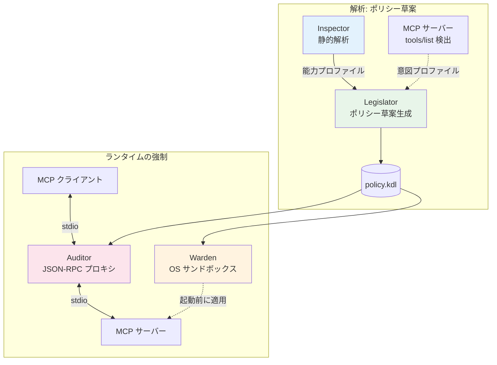
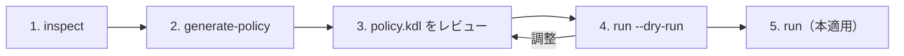
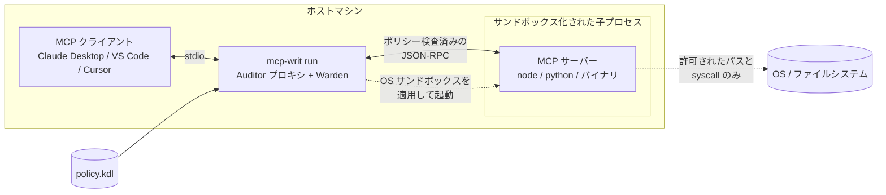

# mcp-writ

> [English](README.md)

ローカル stdio [Model Context Protocol (MCP)](https://modelcontextprotocol.io/) サーバー向けのポリシー執行、OS サンドボックス、JSON-RPC 監査を行います。
mcp-writ は MCP クライアントとサーバーの間に介在し、ファイルシステムのアクセス制御、syscall フィルタリング、ツール許可リスト制御といったきめ細かなセキュリティポリシーを適用します。
ネイティブバイナリの syscall 解析は、Linux x86-64 / AArch64 の ELF バイナリと、macOS ARM64 の Mach-O バイナリが対象です（[対応ターゲット](#対応ターゲット)）。

mcp-writ は制御面のポリシー執行点です。`tools-list-hash` ピンを設定した場合に
サーバーが提示するツール定義を照合し、`tools/call` の許可・拒否、パスと
ホストの引数制約、起動環境の制御、監査ログの記録を担います。データ面の検査 — 応答本文の DLP、HTTP/SSE ゲート
ウェイ、LLM による判定 — は別レイヤーの役割であり、そのような検査器と
直列に接続して使う分担です。

## 特徴

- **多層防御** — Linux・Windows・macOS の OS サンドボックスと JSON-RPC 監査を組み合わせて保護。
- **非特権動作** — root 権限なしで動作。
- **静的解析** — ネイティブ ELF / Mach-O バイナリと対応スクリプト（Python と JavaScript/TypeScript のソース解析。その他のスクリプトは shebang またはコマンド名から識別）を解析し、実行前に必要な権限を調査。
- **ポリシーの生成・検証** — KDL ポリシーの草案を生成。任意のツール検出・自己検証・ドライラン監査で設定の見直しを支援。
- **コンテナ対応** — MCP サーバーのイメージを作成・ラッピングし、Docker / Podman 上でポリシーを適用して実行。
- **ツールのアクセス制御** — ツールの権限と引数を検査し、拒否・未記載のツールを `tools/list` から隠し、機密パスを保護。呼び出し順序の制限も任意で設定。
- **ツール定義の検証** — サーバーが提示するツール定義をスキャンし、ハッシュを照合。変更時は再検証してから呼び出しを再開。

各機能の設定方法、制御の詳細、プラットフォームごとの制約は[詳細ガイド](docs/guide.ja.md)を参照してください。

## アーキテクチャ



Inspector がバイナリと対応するソースを解析し、Legislator が解析結果と任意のツール検出からポリシー草案を作成します。実行時には Warden が OS サンドボックスを適用し、Auditor が MCP 通信を検査します。開発者向けの責務分担は[モジュールガイド](docs/modules.md)を参照してください。

## 対応 MCP バージョン

**stdio** の MCP `2026-07-28` と `2025-11-25` に同一ビルドで対応します。他のバージョンを暗黙に互換とは扱いません。HTTP/SSE トランスポートは設計上の対象外です — stdio が実装済みのランタイムです。
ツール検出、再試行、`inputResponses` の扱いは[プロトコルリファレンス](docs/guide.ja.md#mcp-2026-07-28--2025-11-25--mrtrauditor)を参照してください。

## 対応ターゲット

CLI 本体は Windows / Linux / macOS の x86-64 と ARM64 でビルド・実行でき、リリースワークフローは6つの組み合わせすべてのアーカイブをビルドします。サンドボックスによる強制は OS ごとに異なります（[保護範囲と制約](#保護範囲と制約)を参照）。

`inspect` と `generate-policy` は、CLI を実行するホストとは独立に、入力バイナリの形式・ISA・ABI に従って解析します。

| 入力 | 結果 |
|---|---|
| ELF64 little-endian、x86-64 / AArch64、Linux ABI | syscall サイトをデコードして解決（x86-64 は `syscall`/`rax`、AArch64 は `svc`/`x8`） |
| Mach-O（thin / fat の universal）、plain `arm64` slice、Darwin | `svc #0x80`/`x16` を XNU の BSD syscall 表と Mach trap 表で解決。他の slice は個別の `unsupported` 状態を保持 |
| 解釈系ペイロード（`python`、`node`、スクリプト、shebang） | ネイティブデコードではなくソース / AST の能力解析 |
| その他の形式・ISA・ABI・slice | `unsupported` / `partial` / `failed` の解析状態として報告。「syscall なし」とは表示しない |

ホストごとにどの実行方式（ネイティブ・コンテナ・VM バックエンド）が存在するか、および採用・条件付き・候補・拒否の区別は[対応表](docs/guide.ja.md#実行方式と対応状況)を参照してください。

## クイックスタート

典型的な利用の流れは、解析結果からポリシー草案を作成し、レビューして `--dry-run` で検証したうえで本適用します:



### インストール

[Releases](https://github.com/strumbyte/mcp-writ/releases) から
`mcp-writ-<os>-<arch>`（`.tar.gz` / `.zip`）をダウンロードして展開し、
`mcp-writ` を `PATH` 上に配置してください — アーカイブにはバイナリのほか
`docs/` とコンテナ用 `runners/` が同梱され、ダウンロードはリリース
ページの `checksums-sha256.txt` で検証できます。
[ソース](https://github.com/strumbyte/mcp-writ)から
ビルドする場合（Rust 1.99 以上）:

```sh
cargo install --locked --path . --bin mcp-writ
```

### ウォークスルー: filesystem サーバーをガードする

以下の手順は POSIX シェル（Linux・macOS・WSL）で、ソースチェック
アウト上から実行します — 継承元となるレビュー済みポリシー例が
`examples/` 配下にあるためです。Node.js をインストールし、例には
版を固定した
`@modelcontextprotocol/server-filesystem` `2026.8.31` を使います。
`/srv/mcp-data` は、サーバーにアクセスさせるディレクトリに置き換えてください。

**1. サーバー自体からポリシー草案を作成する。**

```sh
npm install -g @modelcontextprotocol/server-filesystem@2026.8.31
mcp-writ generate-policy --live-discovery --output draft.kdl \
  -- "$(command -v mcp-server-filesystem)" /srv/mcp-data
```

`generate-policy` は npm の shim を解決してパッケージの `dist/index.js`
にたどり着き、制限した環境で `tools/list` を実行して、検証できた内容を
記録します — ドラフトの抜粋:

```kdl
server "auto-generated" {
    // REVIEW: workload hashes pin this host's files — recompute them on the deployment host
    binary-hash     "sha256:…" target="…/bin/node"
    entrypoint-hash "sha256:…" target="…/@modelcontextprotocol/server-filesystem/dist/index.js"
    tools-list-hash "sha256:1ef36fd7…"  // 提示された 14 ツール面
    // Matched: Capability(file:read) ∩ Intent(file:read) [Case A]
    tool "read_file" side_effect="read_only" args_schema="{…}"
    // REVIEW: Tool 'directory_tree' requires file:read but source lacks a matching sink
    tool "directory_tree" deny=#true args_schema="{…}"
    // …検出したツールごとに 1 エントリ
}
```

広告された意図とソース解析で証明された能力が一致したツールは許可として
出力され、解析が証明できなかったものは理由付きの `// REVIEW:` コメントと
`deny=#true` になります。`npx`・`python -m`・inline eval のように
argv から束縛できないペイロードも同様に REVIEW として記録されます —
ドラフトはカバレッジを捏造せず fail-closed です。

**2. レビュー済みの例を継承してこのホスト用に拡張する。**

ドラフトはレビュー用の成果物です — その `tools-list-hash` とツール
ブロックを `examples/policies/filesystem.kdl` のピン留め値と比較して
ください。実運用のポリシーはこの例を継承し（パスを取るすべてのツールに
空の許可リストが宣言済みで、未許可のパスは fail-closed）、ホスト固有の
許可を追加します。ドラフトの `target=` 属性が解決済みのインタプリタと
スクリプトを示しています — ここで解決することもできます:

```sh
node_dir="$(dirname "$(readlink -f "$(command -v node)")")"  # node 実体の bin ディレクトリ
node_prefix="$(dirname "$node_dir")"                          # インストールプレフィックス
npm_root="$(npm root -g)"                                     # グローバルパッケージツリー
# `readlink -f` は GNU 拡張。macOS/BSD では docs/quickstart.ja.md に
# あるリンク解決ループで辿ってください。

cat > policy.kdl <<EOF
policy version=1
extends "examples/policies/filesystem.kdl"
defaults {
    filesystem {
        // ホスト固有の読み取り許可 — node バイナリのディレクトリ、
        // インストールプレフィックス、グローバル npm パッケージツリー。
        // サンドボックス起動に必要な残りのホストパスはクイックスタート
        // 詳解を参照
        allow "$node_dir" mode="read"
        allow "$node_prefix" mode="read"
        allow "$npm_root" mode="read"
        allow "/srv/mcp-data" mode="read"
        secret-overlay #true
    }
    // 子プロセスの環境はこのノードの有無にかかわらず起動規約の
    // 基本セット（PATH・一時ディレクトリ・Windows システム変数）に
    // 制限されます — クラウドキーやトークンなどの認証情報は
    // 子には届きません。このサーバーが実際に必要とする変数だけを
    // `allow "NAME"` で列挙してください。`inherit-parent #true` は
    // 親の環境をそのまま継承する明示的な緩和です。
    environment {
    }
}
server "filesystem" {
    tool "read_file" { filesystem { allow "/srv/mcp-data/**" } }
    // 他のツールは継承した空の許可リストのまま — パスを取る呼び出しは
    // どのパスでも拒否されます（list_allowed_directories はパスを
    // 取らないため応答します）。ツールに `deny=#true` を付けると
    // tools/list からも隠れます。
}
EOF
```

**3. dry-run で検証し、本適用する。**

```sh
mcp-writ run --dry-run --policy policy.kdl --audit-log ./audit.jsonl -- mcp-server-filesystem /srv/mcp-data
```

MCP クライアント（または JSON-RPC スクリプト）をこの `run` コマンドに
向けると、`/srv/mcp-data` 配下の `read_file` は通ります。この例は
`--dry-run` 付きのため OS サンドボックスは無効（ネットワーク拒否も
含む）で、許可範囲外のパスを取る呼び出しは拒否されず、違反として記録
しつつ転送されます。環境変数の制限はここでも適用されますが
認証情報の境界ではありません — サンドボックス無しのサーバーは実行
ユーザーが読める任意のファイル（SSH 鍵、クラウド認証情報、ブラウザ
セッション）を読み取り、どこへでも送信できます。検証用データを使い、
dry-run は認証情報を含まない隔離環境でのみ実行してください。
`--dry-run` を外した通常実行では、許可範囲外のパスを取る呼び出しは
拒否されます。`plan` による起動前診断、サンドボックス有りの検査
（`scripts/check-server.sh` / `.ps1`）、Windows での起動形は
[クイックスタート詳解](docs/quickstart.ja.md)を参照してください。
ポリシーをさらに調整する場合は
[ポリシー作成ガイド](docs/policy-authoring.ja.md)へ。

## クライアント設定

MCP クライアントには、サーバーそのものではなく `mcp-writ run` を起動するよう
設定します — クライアントがガードを起動し、ガードがサンドボックス化した
サーバーを起動します:



Claude Desktop（`claude_desktop_config.json`）と Cursor
（`.cursor/mcp.json`）は `mcpServers.<name>.{command,args,env}` の形です:

```json
{
  "mcpServers": {
    "filesystem": {
      "command": "mcp-writ",
      "args": [
        "run",
        "--policy", "/opt/mcp-config/policy.kdl",
        "--audit-log", "/opt/mcp-logs/audit.jsonl",
        "--", "mcp-server-filesystem", "/srv/mcp-data"
      ],
      "env": {}
    }
  }
}
```

VS Code の `.vscode/mcp.json` では、同じ 3 項目に必須の `"type": "stdio"`
を加えたものが `mcpServers` の代わりにトップレベルの `servers` キーの
下に入ります。`env` に設定した値は `mcp-writ` が動作する親環境の
一部になります — 子プロセスに届くのはポリシーの
`defaults.environment` の `allow` に列挙した変数（および `PATH`・
システム変数のベースライン）だけか、`inherit-parent #true` を
宣言して親の環境をそのまま継承する明示的な緩和（起動記録に残ります）の
場合だけです。`TMPDIR`・`TMP`・`TEMP` が自動設定されるのは
起動経路が専用の一時ディレクトリを割り当てる場合だけで、それ以外の
起動経路で親の値を使うには許可リストに名前を列挙します。クライアントが PATH 上の
`mcp-writ` を見つけられない場合は、`command` に実行ファイルの絶対パスを
指定します。

## サブコマンド

| コマンド | 説明 |
|---------|------|
| `run` | セキュリティポリシーを適用して MCP サーバーを実行 |
| `capability-matrix` | OS 別の機能対応表を機械可読な JSON で出力 — 機構カバレッジ、要件、不足分 |
| `inspect` | ネイティブ ELF / Mach-O、または解釈系ペイロードをソース / AST で解析（`--format human\|json\|kdl`） |
| `generate-policy` | バイナリまたはソース解析からポリシー KDL を生成（デフォルトは静的解析のみ。`--live-discovery` と `--self-test` はオプトイン） |
| `run-image` | ポリシーとログのマウント付きでセキュアなコンテナイメージを実行 |
| `wrap-image` | 既存イメージを `mcp-secure-runner` でラップ（ポリシーを焼き込み） |
| `containerize` | MCP サーバーのソースディレクトリからセキュアなイメージをビルド |
| `plan` | ワークロードを起動せずに起動前提条件を診断し、強制計画を表示 |
| `check` | ポリシーのハッシュ pin（`binary`/`entrypoint`/`lockfile`/`docker-manifest`/`tools-list`）と `REVIEW` マーカーを現行アーティファクトと再照合 — CI 向けドリフト検出の終了コード |

### 使用例

```bash
# ネイティブバイナリ、またはスクリプトを解析（解釈系ではネイティブ解析をスキップ）
mcp-writ inspect ./my-mcp-server --format json
mcp-writ inspect --format json server.py
```

Python / JavaScript / TypeScript のサーバーでは、`inspect` がツール登録を
静的に束縛します — Python では `@mcp.tool()` デコレータと
`add_tool("name", fn)` 呼び出し、JS/TS ではリテラルな
`server.tool("name", …)` / `registerTool("name", …)` 呼び出し — 各ツールの
証明できた能力を、同一モジュール内のヘルパー呼び出し経由の伝播も含めて
報告します:

```console
$ mcp-writ inspect server.py
native analysis skipped; source payload = server.py

=== Source Tools ===
  - read_file [bound]: file:read
  - fetch_url [bound]: network:outbound
```

解決できない登録（動的なツール名、非リテラルな `add_tool` 引数）は、
黙って落とすのではなく `unbound` として警告付きで報告します。
`--format json` でも同じ内容を `source_tools` 配下に出力するため、
CI から利用できます。

```bash
# OS サンドボックスを無効にして実行し、ツール呼び出しの違反を記録・転送
# （サーバー実行に副作用の可能性あり。ツール定義の遮断検査は継続）
mcp-writ run --dry-run --policy policy.kdl --audit-log ./audit.jsonl -- ./my-mcp-server

# 監査ログファイル付きで実行
mcp-writ run --policy policy.kdl --audit-log /var/log/mcp-audit.jsonl -- ./my-mcp-server

# コンテナイメージをラップして実行
mcp-writ wrap-image --policy policy.kdl my-mcp-server:latest
# このローカルビルド例では、変更可能なタグを明示的に許可
mcp-writ run-image --allow-mutable-tag --engine docker --policy policy.kdl --log-dir ./logs my-mcp-server-secured:latest
```

## ポリシーファイル

ポリシーは [KDL](https://kdl.dev/) で定義します。以下は Linux 向けの構文例です。パス、システムコール、ツール名はサーバーに合わせて調整してください。

```kdl
policy version=1

defaults {
    filesystem {
        allow "/usr/lib/**" mode="read"
        allow "/etc/ssl/certs/**" mode="read"
        allow "/workspace/**" mode="write"
    }
    syscalls {
        allow "read" "write" "openat" "close" "fstat" "mmap" "brk" "execve" "exit_group"
    }
}

server "my-mcp-server" {
    // input_responses="auto" は制約を持つツールへの別入力を拒否する。
    tool "read_file" side_effect="read_only" {
        filesystem {
            allow "/workspace/**"
            deny "/home/*/.ssh/**"
        }
    }
    tool "exec_shell" deny=#true
}
```

完全な例（`secret-overlay`、`side_effect`、オプトインの `trajectory`、MRTR の `input_responses` 注記を含む）は [policy.example.kdl](policy.example.kdl) を参照してください。Windows ではホスト allowlist と `deny host="*"` の組み合わせはポリシー読み込み時に拒否されます。詳細は [プラットフォーム注記（Windows）](docs/guide.ja.md#プラットフォーム注記windows) を参照してください。

## 保護範囲と制約

保護の範囲はポリシーと OS に依存します — [OS 別の適用範囲](docs/guide.ja.md#os-別の適用範囲)が各設定領域の OS ごとの扱いを対応づけており、[`mcp-writ capability-matrix`](docs/guide.ja.md#414-capability-matrix--機械可読機能マトリクス)が同じ内容を機械可読な JSON として出力します（[docs/capability-matrix.json](docs/capability-matrix.json) — 実装との同期をテストで検証）。

**ガードが強制すること**

- **Linux（主対象）:** Landlock によるファイルシステム制限と seccomp
  許可リスト、`no_new_privs`。許可したツールの `filesystem` 規則は
  プロセス共通の ruleset に合成されます。
- **Windows:** AppContainer と Job Object、DACL 付与。OS の通信制御は
  全拒否か無制限のいずれかで、宛先単位の OS 制御はありません。
  opt-in の `--windows-mechanism psec`（条件付き・x86-64 のみ）は
  AppContainer 層を PSEC セキュリティ環境へ置き換え、IPv4 宛先単位の
  egress 制御を強制します — [プラットフォーム注記](docs/guide.ja.md#プラットフォーム注記windows)
  を参照してください。
- **macOS:** `sandbox-exec`（旧式の SBPL）がグローバルの `filesystem`
  リストを強制します。ツール単位の `filesystem`/`network` は Auditor
  のみの検査で、`defaults.syscalls` は適用されません。
- **全 OS 共通:** 通常実行ではツール許可リスト、`args_schema`、
  `side_effect`、秘密パスオーバーレイが `tools/call` の引数に対して
  検査され、違反は JSON-RPC エラーとして返ります。`tools-list-hash` は
  `tools/list` 応答と照合され、不一致時はエラー応答を返してセッションを
  中断します。`--dry-run` では `tools/call` の違反を転送し（`observed`
  として記録）、クライアント起点の `tools/list` ピン不一致も中断せず
  転送します。子プロセスの環境は `defaults.environment` ノードの有無に
  かかわらず起動規約の基本セットに制限され、`--dry-run` と
  `MCP_WRIT_SKIP_SANDBOX` の実行でも適用されます。`allow` エントリは
  列挙した親変数だけを子へ渡し、`inherit-parent #true` を宣言した
  場合だけ親の環境をそのまま継承します。
- **spawn 前:** 起動対象への `binary-hash` / `entrypoint-hash` ピンを
  検証し、解決済み実行ファイル / 第 1 ペイロード引数へ束縛し、
  `exec` 直前に再検証します。再検証では実行ファイルと、第 1
  ペイロード引数に一致した entrypoint の両方を内容で再ハッシュします
  — 初回検証の後で差し替えられたスクリプトは、パス一致だけでは通らず
  fail-closed で拒否します。さらに `exec` はパス名ではなく pin 済み
  オブジェクト自体をマップします（Unix では fd/ステージ済みスナップ
  ショット、Windows では share-mode で保持したハンドル）。これらのピンを宣言したポリシーでは、ハッシュ不一致と
  inline eval の起動は fail-closed で拒否します。argv から束縛できないペイロード（`python -m`、`npx`）
  は pin されません — `generate-policy` はハッシュを捏造せず
  `// REVIEW:` コメントでギャップを記録します。そのような
  ペイロードを pin するには、解決済みエントリポイントを直接起動し
  インタプリタとスクリプトを両方 pin してください
  （[詳細](docs/guide.ja.md#82-ランチャー型起動のピン留めnpxpython--m-など)）。

**保証しないこと**

- ツール単位の `filesystem`/`network` 規則は RPC 引数の検査であり、
  ツールごとの OS サンドボックスではありません。サーバー内部の
  アクセスは対象外です — この形は構造的なものです。mcp-writ は
  無改造のサーバーを 1 つの stdio 子プロセスとしてラップするため、
  OS 規則は起動時に許可ツール全件の和集合として一度だけ適用され、
  カーネルは後の内部アクセスがどの `tools/call` に由来するかを
  区別できません。呼び出し単位の OS 境界にはサーバー内部の協調
  コードが必要です。権限の両立しないツールを持つサーバーは、別々の
  ガード付きサーバーに分割するか `--isolation` バックエンドへ
  移してください。
- `--dry-run` は OS サンドボックス無しでサーバーを実行します。違反は
  記録されつつ転送されるため、実行に副作用が起こり得ます。
- 引数検査と利用の間の TOCTOU は Auditor の対象外です。OS 規則が
  覆うファイルシステムパスは `open` 時点で再判定されますが、それ以外の
  引数は検査時点のみです — サーバーによる後の利用は再判定されません。
- egress 強制経路には文書化された残存リスクがあります — 許可済み TLS
  内の DoH、共有 IP の同居テナント、TTL スコープの grant 窓、上流を
  信用する CNAME 委譲、ユーザ空間プロキシ自体への信頼。
  [構造的限界と残存リスク](docs/guide.ja.md#8-構造的限界と残存リスク)
  が固定された一覧です — 自身の脅威モデルに照合してください。
- `confused_deputy_protection` はオプトインの、プロセス単位の
  `known_paths` による list→read 検査です — 汎用の混乱した代理人
  対策ではありません。役割はツールごとの `deputy` ブロックで明示
  （スキーマ v2）。ブロックが無ければ固定名 `list_files` /
  `list_directory`（発見）と `read_file`（利用）の互換マッピングが
  適用されます。役割の結び付かないツールにはこの機能の検査が
  かかりません（通常のポリシー検査はそのまま適用されます）。
  子プロセスを共有するクライアントはその集合も共有します。
- 応答本文の DLP／マスキング、HTTP/SSE トランスポート、LLM による
  判定は別レイヤーの役割です（冒頭の位置づけを参照）。

運用ポリシーを決める前に[セキュリティモデル](docs/guide.ja.md#2-セキュリティモデル)を確認してください。

## ビルドと開発

```sh
cargo build --locked --release --bins
cargo test --locked
```

最小 Rust バージョンは 1.99.0 です。開発と CI で使用するバージョンは `rust-toolchain.toml` で固定しています。バイナリ解析の対象範囲と OS サンドボックスの制約はユーザーガイドを参照してください。結合テストには Python 3、コンテナテストには Docker が必要です。

検証コマンドと CI の役割は[開発手順](docs/development.md)、公開作業は[リリース手順](docs/releasing.md)にまとめています。

## ライセンス

MITライセンスで公開しています。詳細は [LICENSE](LICENSE) を参照してください。

## ドキュメント

- [ドキュメント一覧](docs/README.md)
- [ユーザーガイド](docs/guide.ja.md) / [English guide](docs/guide.md)
- [ポリシー作成ガイド](docs/policy-authoring.ja.md) / [Writing a policy](docs/policy-authoring.md)
- [ポリシーの記述例](policy.example.kdl)
- [モジュールガイド](docs/modules.md)
- [開発手順](docs/development.md) / [リリース手順](docs/releasing.md)
