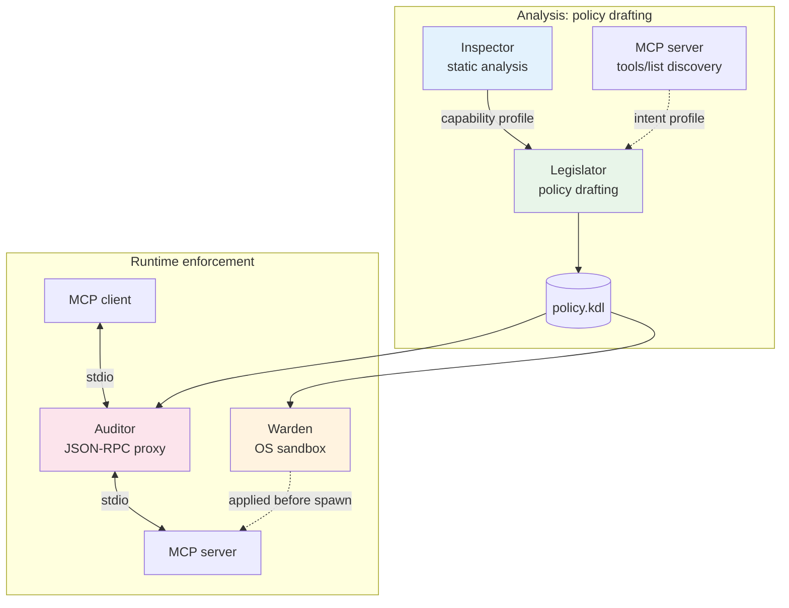
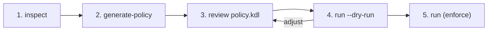
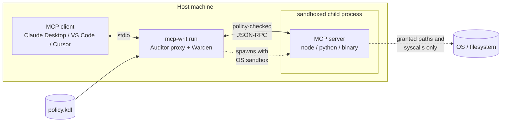

# mcp-writ

> [日本語版 / Japanese](README.ja.md)

Policy enforcement, OS sandboxing, and JSON-RPC auditing for local stdio
[Model Context Protocol (MCP)](https://modelcontextprotocol.io/) servers.
mcp-writ sits between the MCP client and server, enforcing fine-grained security policies — filesystem access control, syscall filtering, and tool allowlisting.
Native syscall analysis covers Linux x86-64 and AArch64 ELF binaries and macOS
ARM64 Mach-O binaries — see [Supported targets](#supported-targets).

mcp-writ is a control-plane enforcement point: it verifies the server's
tool definitions when a `tools-list-hash` pin is configured, permits or
denies `tools/call`, constrains path and host arguments, controls the
launch environment, and records an audit log.
Data-plane inspection — response-body DLP, HTTP/SSE gateways, LLM-based
judgment — is a different layer's job; deploy mcp-writ in series with such
inspectors rather than expecting it to replace them.

## Features

- **Multi-layer defense** — OS sandboxing on Linux, Windows, and macOS, combined with JSON-RPC auditing.
- **Non-privileged operation** — runs without root privileges.
- **Static analysis** — inspect native ELF and Mach-O binaries and supported scripts — Python and JavaScript/TypeScript sources; other script files are identified from their shebang or the command name — to surface capabilities before execution.
- **Policy generation and testing** — generate KDL policy drafts, with optional tool discovery, self-tests, and dry-run auditing to help review them.
- **Container support** — build and wrap MCP server images, then run them with policy enforcement using Docker or Podman.
- **Tool access controls** — check tool permissions and arguments, hide denied or unlisted tools from `tools/list`, protect sensitive paths, and optionally restrict sequences of tool calls.
- **Tool definition verification** — scan advertised tool definitions, verify pinned hashes, and revalidate changes before resuming tool calls.

See the [detailed guide](docs/guide.md) for configuration, enforcement behavior, and platform limitations.

## Architecture



Inspector analyzes binaries and supported source files. Legislator uses those
results and optional live tool discovery to draft a policy. At runtime, Warden
applies the OS sandbox and Auditor checks MCP traffic. See the
[module guide](docs/modules.md) for module responsibilities.

## Supported MCP versions

mcp-writ supports **stdio** MCP `2026-07-28` and `2025-11-25` in the same build.
Other revisions are not assumed compatible. HTTP/SSE transport is out of scope
by design — stdio is the implemented runtime.
See the [protocol reference](docs/guide.md#mcp-2026-07-28--2025-11-25--mrtr-auditor)
for discovery, retries, and `inputResponses` handling.

## Supported targets

The CLI itself builds and runs on Windows, Linux, and macOS on x86-64 and
ARM64; the release workflow builds archives for all six combinations.
Sandbox enforcement is OS-specific — see
[Security boundaries](#security-boundaries).

`inspect` and `generate-policy` analyze the input binary's format, ISA, and
ABI independently of the host the CLI runs on:

| Input | Result |
|---|---|
| ELF64 little-endian, x86-64 or AArch64, Linux ABI | Syscall sites decoded and resolved (`syscall`/`rax` on x86-64, `svc`/`x8` on AArch64) |
| Mach-O thin or fat (universal), plain `arm64` slice, Darwin | `svc #0x80`/`x16` resolved against XNU BSD syscall and Mach trap tables; other slices keep their own `unsupported` state |
| Interpreter payloads (`python`, `node`, scripts, shebang) | Source/AST capability analysis instead of native decoding |
| Other formats, ISAs, ABIs, or slices | Reported with `unsupported` / `partial` / `failed` analysis state — never presented as "no syscalls" |

Which execution method (native, container, or a VM backend) exists for a
given host — and whether it is adopted, conditional, a candidate, or
refused — is listed in the
[support matrix](docs/guide.md#execution-methods-and-support-status).

## Quick Start

The typical workflow drafts a policy from analysis, reviews it, verifies the
server's behavior under `--dry-run`, then enforces:



### Install

Download `mcp-writ-<os>-<arch>` (`.tar.gz` or `.zip`) from
[Releases](https://github.com/strumbyte/mcp-writ/releases), unpack it, and
put `mcp-writ` on `PATH` — the archive carries `docs/` and the container
`runners/` tree beside the binary; the release page's
`checksums-sha256.txt` verifies the download. Or build from a
[source checkout](https://github.com/strumbyte/mcp-writ) — Rust 1.99+:

```sh
cargo install --locked --path . --bin mcp-writ
```

### Walkthrough: guarding the filesystem server

The steps below run on a POSIX shell (Linux, macOS, or WSL) from a
source checkout — the reviewed example policy they extend lives under
`examples/` — with Node.js installed, using the pinned
`@modelcontextprotocol/server-filesystem` `1.0.0` server.
Replace `/srv/mcp-data` with the directory the server may reach.

**1. Draft a policy from the server itself.**

```sh
npm install -g @modelcontextprotocol/server-filesystem@1.0.0
mcp-writ generate-policy --live-discovery --output draft.kdl \
  -- "$(command -v mcp-server-filesystem)" /srv/mcp-data
```

`generate-policy` resolves the npm shim to the package's `dist/index.js`,
runs `tools/list` in a restricted environment, and records what it
verified — an excerpt of the draft:

```kdl
server "auto-generated" {
    // REVIEW: workload hashes pin this host's files — recompute them on the deployment host
    binary-hash     "sha256:…" target="…/bin/node"
    entrypoint-hash "sha256:…" target="…/@modelcontextprotocol/server-filesystem/dist/index.js"
    tools-list-hash "sha256:356bc86b…"  // the advertised 14-tool surface
    // Matched: Capability(file:read) ∩ Intent(file:read) [Case A]
    tool "read_file" side_effect="read_only" args_schema="{…}"
    // REVIEW: Tool 'directory_tree' requires file:read but source lacks a matching sink
    tool "directory_tree" deny=#true args_schema="{…}"
    // …one entry per discovered tool
}
```

Tools whose advertised intent matches a source-proven capability are
emitted allowed; everything the analyzer cannot prove comes out
`deny=#true` with a `// REVIEW:` reason, and payloads it cannot bind
(`npx`, `python -m`, inline eval) are flagged the same way — the draft
fails closed rather than fabricating coverage.

**2. Extend the reviewed example for this host.**

The draft is a review artifact — compare its `tools-list-hash` and tool
blocks against the pinned values in `examples/policies/filesystem.kdl`.
For the deployable policy, extend that example (every path-taking tool
carries an empty allow-list, so ungranted paths fail closed) and add
this host's grants. The draft's `target=` attributes already name the
resolved interpreter and script — or resolve them here:

```sh
node_dir="$(dirname "$(readlink -f "$(command -v node)")")"  # real node bin dir
node_prefix="$(dirname "$node_dir")"                          # install prefix
npm_root="$(npm root -g)"                                     # global package tree
# `readlink -f` is GNU; on macOS/BSD resolve the link chain as shown in
# docs/quickstart.md.

cat > policy.kdl <<EOF
policy version=1
extends "examples/policies/filesystem.kdl"
defaults {
    filesystem {
        // Host-specific read grants — the node binary's directory, its
        // install prefix, and the global npm package tree. Sandboxed
        // launch needs the remaining host paths from the quickstart
        // walkthrough.
        allow "$node_dir" mode="read"
        allow "$node_prefix" mode="read"
        allow "$npm_root" mode="read"
        allow "/srv/mcp-data" mode="read"
        secret-overlay #true
    }
    // The child's environment is already restricted to the launch
    // contract's base set (PATH, temp dirs, Windows system vars) —
    // ambient credentials (cloud keys, tokens) never reach it, with or
    // without this node. Add `allow "NAME"` entries to pass through
    // only the variables this server demonstrably needs;
    // `inherit-parent #true` would restore ambient inheritance as an
    // explicit downgrade.
    environment {
    }
}
server "filesystem" {
    tool "read_file" { filesystem { allow "/srv/mcp-data/**" } }
    // The other tools keep the inherited empty allow-list — path-taking
    // calls stay denied for any path (list_allowed_directories takes no
    // path and still answers). Add `deny=#true` to a tool to also hide
    // it from tools/list.
}
EOF
```

**3. Dry-run, then enforce.**

```sh
mcp-writ run --dry-run --policy policy.kdl --audit-log ./audit.jsonl -- mcp-server-filesystem /srv/mcp-data
```

Point an MCP client (or a JSON-RPC script) at that `run` command: `read_file`
under `/srv/mcp-data` goes through. This example passes `--dry-run`, which
keeps the OS sandbox off — including the network deny — and forwards calls
taking other paths while logging them as violations. The restricted
child environment applies here too but is not a credential
boundary: an unsandboxed server can read any file the running user can —
SSH keys, cloud credentials, browser sessions — and send them anywhere. Use test
data, and run dry-run only inside an isolated environment containing no
credentials. Without `--dry-run`, normal execution denies calls outside
the allowance. For `plan` preflight diagnostics, the sandboxed check
(`scripts/check-server.sh` / `.ps1`), and the Windows launch form, see the
[quickstart walkthrough](docs/quickstart.md); tailor the policy further with
the [policy authoring guide](docs/policy-authoring.md).

## Client configuration

Point your MCP client at `mcp-writ run` instead of launching the server
directly — the client spawns the guard, and the guard spawns the sandboxed
server:



Claude Desktop (`claude_desktop_config.json`) and Cursor
(`.cursor/mcp.json`) use the `mcpServers.<name>.{command,args,env}` shape:

```json
{
  "mcpServers": {
    "filesystem": {
      "command": "mcp-writ",
      "args": [
        "run",
        "--policy", "/opt/mcp-config/policy.kdl",
        "--audit-log", "/opt/mcp-logs/audit.jsonl",
        "--", "mcp-server-filesystem", "/srv/mcp-data"
      ],
      "env": {}
    }
  }
}
```

VS Code's `.vscode/mcp.json` uses the same three fields under a top-level
`servers` key instead of `mcpServers`, plus a required `"type": "stdio"`
on each server entry. Values set in `env` are passed to the
parent environment `mcp-writ` runs under — a variable reaches the
spawned child only when the policy's `defaults.environment` lists it in
`allow` (or it is one of the baseline `PATH` / system variables), or when
the policy declares `inherit-parent #true` (an explicit downgrade that is
recorded on the launch). `TMPDIR`, `TMP`, and `TEMP` are injected automatically
only on launch paths that assign a dedicated private temporary directory;
on other launch paths, list them in the allowlist to pass the parent's
values. If the client cannot find `mcp-writ` on
`PATH`, put the absolute executable path in `command`.

## Subcommands

| Command | Description |
|---------|-------------|
| `run` | Run an MCP server with security policies applied |
| `capability-matrix` | Print the machine-readable per-OS capability matrix (JSON) — mechanism coverage, requirements, deficiencies |
| `inspect` | Analyze a native ELF or Mach-O binary, or an interpreter payload via source/AST (`--format human\|json\|kdl`) |
| `generate-policy` | Generate a policy KDL from binary or source analysis (static-only by default; `--live-discovery` and `--self-test` are opt-in) |
| `run-image` | Run a secured container image with policy and log mounts |
| `wrap-image` | Wrap an existing image with `mcp-secure-runner` (policy baked in) |
| `containerize` | Build a secured image from an MCP server source directory |
| `plan` | Diagnose launch prerequisites and print the enforcement plan without starting the workload |
| `check` | Re-verify a policy's hash pins (`binary`/`entrypoint`/`lockfile`/`docker-manifest`/`tools-list`) and `REVIEW` markers against current artifacts — drift-detection exit codes for CI |

### Examples

```bash
# Inspect a native binary, or a script (native analysis is skipped for interpreters)
mcp-writ inspect ./my-mcp-server --format json
mcp-writ inspect --format json server.py
```

For a Python or JavaScript/TypeScript server, `inspect` binds tool
registrations statically — `@mcp.tool()` decorators and
`add_tool("name", fn)` calls in Python, literal `server.tool("name", …)` /
`registerTool("name", …)` calls in JS/TS — and reports each tool's proven
capabilities, propagated through same-module helper calls:

```console
$ mcp-writ inspect server.py
native analysis skipped; source payload = server.py

=== Source Tools ===
  - read_file [bound]: file:read
  - fetch_url [bound]: network:outbound
```

A registration it cannot resolve (a dynamic tool name, a non-literal
`add_tool` argument) is reported `unbound` with a warning rather than
dropped silently, and `--format json` carries the same data under
`source_tools` for CI consumption.

```bash
# Log and forward tool-call violations without OS sandboxing (server
# execution may have side effects; blocking tool-definition checks still apply)
mcp-writ run --dry-run --policy policy.kdl --audit-log ./audit.jsonl -- ./my-mcp-server

# Run with audit log file
mcp-writ run --policy policy.kdl --audit-log /var/log/mcp-audit.jsonl -- ./my-mcp-server

# Wrap then run a container image
mcp-writ wrap-image --policy policy.kdl my-mcp-server:latest
# For this local build, explicitly allow the mutable tag
mcp-writ run-image --allow-mutable-tag --engine docker --policy policy.kdl --log-dir ./logs my-mcp-server-secured:latest
```

## Policy File

Policies are defined in [KDL](https://kdl.dev/). This Linux-oriented example illustrates the syntax; adapt paths, syscalls, and tools to your server:

```kdl
policy version=1

defaults {
    filesystem {
        allow "/usr/lib/**" mode="read"
        allow "/etc/ssl/certs/**" mode="read"
        allow "/workspace/**" mode="write"
    }
    syscalls {
        allow "read" "write" "openat" "close" "fstat" "mmap" "brk" "execve" "exit_group"
    }
}

server "my-mcp-server" {
    // input_responses="auto" denies separate inputs on constrained tools.
    tool "read_file" side_effect="read_only" {
        filesystem {
            allow "/workspace/**"
            deny "/home/*/.ssh/**"
        }
    }
    tool "exec_shell" deny=#true
}
```

See [policy.example.kdl](policy.example.kdl) for a complete example (including `secret-overlay`, `side_effect`, opt-in `trajectory`, and the MRTR `input_responses` note). On Windows, a host allowlist combined with `deny host="*"` is rejected at policy load; see [Platform notes (Windows)](docs/guide.md#platform-notes-windows).

## Security boundaries

Protection depends on the policy and platform — the
[per-OS enforcement matrix](docs/guide.md#per-os-enforcement-matrix) maps each
policy area to its per-OS behavior, and
[`mcp-writ capability-matrix`](docs/guide.md#414-capability-matrix--machine-readable-feature-matrix)
emits the same claims as machine-readable JSON
([docs/capability-matrix.json](docs/capability-matrix.json), kept in sync
with the implementation by test).

The native warden is **Linux-first** by design — Landlock + seccomp is the
mechanism whose guarantees are most completely verifiable. On other OSes
the native mechanism is what the platform offers; when a workload needs a
stronger boundary, the design's answer is an isolation route
(`--isolation kata|apple-container|hyperv|windows-sandbox`, or an OCI
container), never a silent substitute.

**What the guard enforces**

- **Linux (the primary target):** Landlock filesystem confinement plus a
  seccomp allowlist and `no_new_privs`; allowed tools' `filesystem` rules
  merge into one process-wide ruleset.
- **Windows:** AppContainer, Job Object, and DACL grants; OS network control
  is deny-all or unrestricted — no per-destination OS filtering. An opt-in
  `--windows-mechanism psec` (conditional, x86-64 only) replaces the
  AppContainer layer with a PSEC security environment that does enforce
  per-destination IPv4 egress — see the
  [platform notes](docs/guide.md#platform-notes-windows).
- **macOS:** `sandbox-exec` (legacy SBPL) enforces the global `filesystem`
  lists; per-tool `filesystem`/`network` is Auditor-only and
  `defaults.syscalls` is not applied.
- **Everywhere:** in a normal run, the tool allowlist, `args_schema`,
  `side_effect`, and the secret-path overlay are checked on `tools/call`
  arguments; violations return a JSON-RPC error. `tools-list-hash` is
  compared against the `tools/list` response — on a mismatch the guard
  returns an error response and aborts the session. Under `--dry-run`
  `tools/call` violations are forwarded instead (logged `observed`), and a
  client-initiated `tools/list` pin mismatch is also forwarded rather than
  aborting. The child process's environment is restricted to the launch
  contract's base set at launch — including `--dry-run` and
  `MCP_WRIT_SKIP_SANDBOX` runs — whether or not a `defaults.environment`
  node exists; its `allow` entries pass named parent variables through,
  and ambient inheritance returns only via `inherit-parent #true`.
- **Before spawn:** `binary-hash` / `entrypoint-hash` pins on the launch
  target are verified, bound to the resolved executable / first payload
  argument, and re-verified immediately before `exec` — the executable
  and a matched entrypoint script are both re-hashed there, so a script
  swapped in after the first check fails closed instead of passing on
  path correspondence alone, and `exec` then maps the pinned object
  itself (an inherited `/proc/self/fd` snapshot on Linux, a staged copy
  on other Unix, a share-mode-held handle on Windows) rather than the
  pathname. With such pins declared, a hash mismatch or an
  inline-eval launch fails closed.
  Payloads that cannot be bound from argv (`python -m`, `npx`) are not
  pinned; `generate-policy` records the gap as a `// REVIEW:` comment
  instead of fabricating a hash — to pin such a payload, launch the
  resolved entrypoint directly and pin interpreter + script together
  ([details](docs/guide.md#82-pinning-launcher-based-workloads-npx-python--m-)).

**What it does not guarantee**

- Per-tool `filesystem`/`network` rules inspect RPC arguments; they are not
  a per-tool OS sandbox and do not cover server-internal access. That shape
  is structural: mcp-writ wraps an unmodified server as a single stdio
  child process, so the OS rules are applied once at spawn as the union of
  every allowed tool's grants — the kernel cannot attribute a later
  internal access to the `tools/call` it served. A per-call OS boundary
  would require cooperating code inside the server; if one server holds
  tools with irreconcilable privileges, split it into separate guarded
  servers or route it through an `--isolation` backend.
- `--dry-run` runs the server without the OS sandbox; violations are logged
  and forwarded — execution can have real side effects.
- TOCTOU between argument check and use is outside the Auditor's scope:
  filesystem paths covered by an OS rule are re-judged at open time, but
  every other argument is check-time only — the server's later use of it
  is not re-judged.
- The egress-enforcement paths keep documented residuals — DoH inside an
  allowed TLS flow, shared-IP co-tenancy, TTL-scoped grant windows,
  upstream-trusted CNAME delegation, and trust in the userspace proxy
  itself. [Structural limits and residual
  risks](docs/guide.md#8-structural-limits-and-residual-risks) is the
  fixed list — check it against your threat model.
- `confused_deputy_protection` is opt-in — a per-process `known_paths`
  list→read guard, not a general confused-deputy defense. Roles are
  explicit per-tool `deputy` blocks (schema v2); without one, the fixed
  names `list_files` / `list_directory` (discover) and `read_file` (use)
  apply as a compatibility mapping. Tools with no bound role run no check
  from this feature (their normal policy checks still apply), and clients
  sharing one child process share the set.
- Response-body DLP/redaction, HTTP/SSE transport, and LLM-based moderation
  belong to other layers — see the positioning note at the top.

See the [security model](docs/guide.md#2-security-model) before choosing a
deployment policy.

## Build and development

```sh
cargo build --locked --release --bins
cargo test --locked
```

The minimum Rust version is 1.99.0; `rust-toolchain.toml` pins the toolchain used
for development and CI. Binary analysis coverage and OS sandbox support have
platform constraints documented in the user guide. Python 3 is needed for
integration fixtures, and Docker is needed for container tests.

See [Development](docs/development.md) for verification commands and workflow
responsibilities, and [Releasing](docs/releasing.md) for publication procedures.

## License

Licensed under the MIT License. See [LICENSE](LICENSE).

## Documentation

- [Documentation index](docs/README.md)
- [User guide](docs/guide.md) / [日本語ガイド](docs/guide.ja.md)
- [Writing a policy](docs/policy-authoring.md) / [ポリシー作成ガイド](docs/policy-authoring.ja.md)
- [Policy example](policy.example.kdl)
- [Module guide](docs/modules.md)
- [Development](docs/development.md) / [Releasing](docs/releasing.md)
